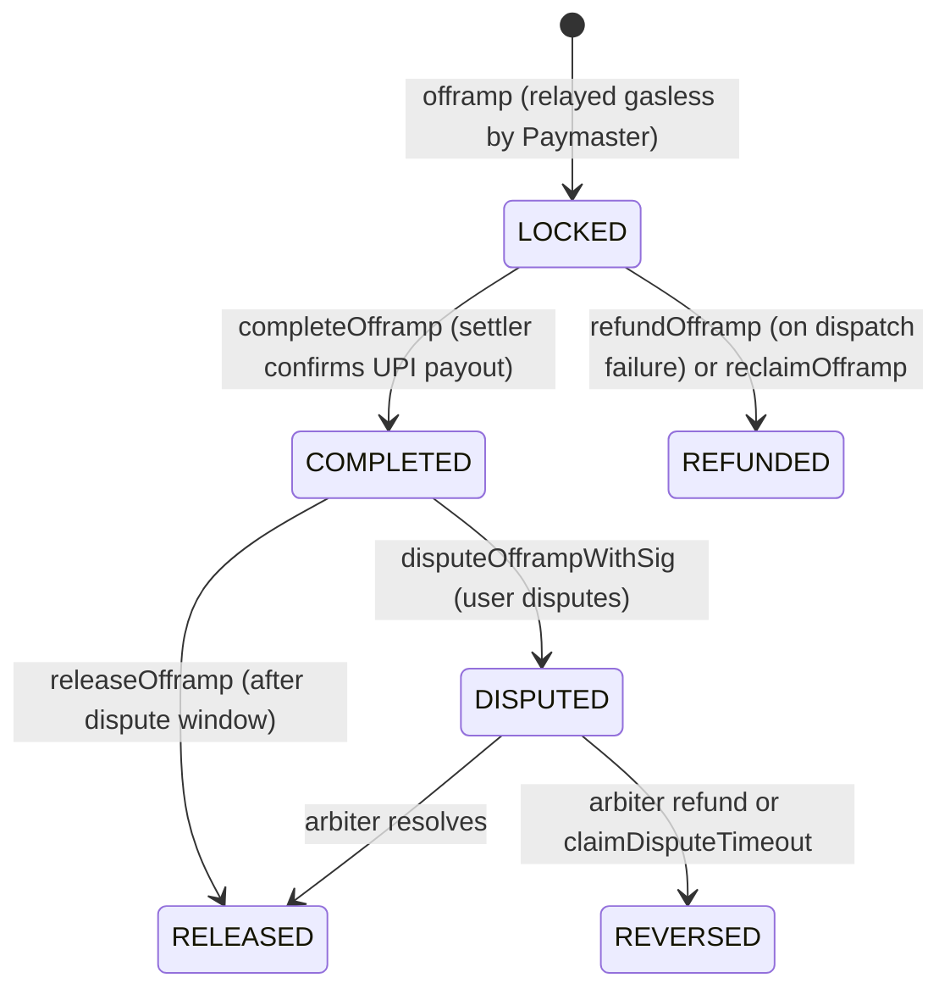

# ArcPay

> **Scan any UPI QR and pay with stablecoins on Arc Network with zero gas fees. Merchants receive Indian Rupees (INR) instantly.**

ArcPay is a decentralized payment gateway bridging Web3 stablecoins (USDC/USDT) directly to India's Unified Payments Interface (UPI). The payer signs in their standard Web3 wallet (MetaMask, Rabby, or smart account) and pays zero gas. The merchant receives rupees directly into their bank account via UPI.

Funds are locked inside the on-chain [`ArcPayVault`](contracts/src/ArcPayVault.sol) escrow smart contract, featuring an automated state machine and user-controlled dispute windows before settlement.

---

## Architecture Overview

ArcPay consists of three modular components:

```
┌─────────────────┐       EIP-712 Quote / Relay       ┌──────────────────────┐
│  ArcPay Web App │ ────────────────────────────────> │   ArcPay Node API    │
│  (React / Vite) │ <──────────────────────────────── │ (Express/TypeScript) │
└─────────────────┘                                   └──────────────────────┘
        │                                                         │
        │ signs permit & intent                                   │ relays gasless tx
        ▼                                                         ▼
┌─────────────────────────────────────────────────────────────────────────────┐
│                 ArcPayVault Smart Contract (Arc Network)                   │
│   [LOCKED] ──> [COMPLETED] ──> (Dispute Window) ──> [RELEASED] to Pool      │
└─────────────────────────────────────────────────────────────────────────────┘
                                                                  │
                                                        payout in INR via UPI
                                                                  ▼
                                                      ┌──────────────────────┐
                                                      │  Indian UPI Merchant │
                                                      └──────────────────────┘
```

1. **Smart Contracts ([`contracts/`](contracts/))**:
   - [`ArcPayVault.sol`](contracts/src/ArcPayVault.sol): Non-custodial escrow vault with EIP-712 intent authorization, dispute protection, and emergency timelocks.
2. **Backend API ([`services/api-node/`](services/api-node/))**:
   - Node.js & TypeScript service powered by `viem`.
   - Gasless paymaster relayer.
   - Real-time UPI QR decoding & verification.
   - Automated FX rate pricing with slippage protection.
3. **Web Application ([`apps/web/`](apps/web/))**:
   - Progressive Web App (PWA) built with React, Vite, and Viem.
   - Live camera QR scanner.
   - Mobile wallet deep-linking (MetaMask, WalletConnect).

---

## State Machine & Security

Every payment follows an on-chain finite state machine:



* **LOCKED**: Tokens are deposited into the vault while fiat settlement occurs.
* **COMPLETED**: Payout reference is committed on-chain, opening the dispute window.
* **DISPUTED**: User can freeze funds if UPI payment is unfulfilled.
* **RELEASED / REVERSED**: Funds either enter the liquidity pool or return to the user.

---

## Tech Stack

* **Contracts**: Solidity `^0.8.20`, Foundry, OpenZeppelin v5.
* **Backend**: Node.js, TypeScript, Express, Viem, SQLite.
* **Frontend**: React 19, Vite, MUI, TypeScript, PWA.
* **Networks Supported**: Arc Testnet (5042002), Arc Mainnet (5042), Whitechain Sepolia (1874).

---

## Quickstart & Local Setup

### Prerequisites
* Node.js v20+ & npm
* Foundry (`forge`)

### 1. Install & Run Backend API
```bash
cd services/api-node
npm install
npm run dev
# Running on http://localhost:8788
```

### 2. Install & Run Web App
```bash
cd apps/web
npm install
npm run dev
# Running on http://localhost:5173
```

### 3. Compile & Test Smart Contracts
```bash
cd contracts
forge test
```

---

## License

MIT © JIGNESHVH
